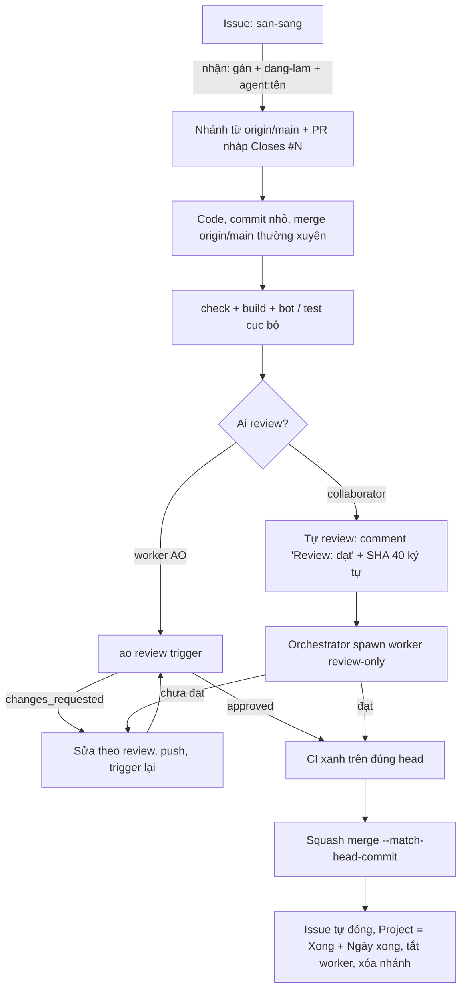

# 01. Tổng quan: vai trò và vòng đời một việc

## Áp dụng chung

### Nguyên tắc nền
1. **Mọi việc đi qua issue GitHub.** Issue là hàng chờ; nhãn là nguồn sự thật; không có việc nào "ngầm" ở file cục bộ mà người khác không thấy.
2. **Một issue = một nhánh = một PR.** PR nháp mở ngay khi nhận việc (`Closes #<N>`) để ai cũng thấy việc đã có người làm.
3. **Không ai push thẳng vào nhánh chính, không ai force push.** Cập nhật nhánh bằng `git merge origin/main`.
4. **Tác giả không tự duyệt.** PR của worker do reviewer độc lập duyệt; PR của collaborator do orchestrator kiểm lại bằng một worker review-only.
5. **Tài liệu quy tắc nằm trong repo** (agent nào cũng đọc được); phần chỉ orchestrator cần (nhịp, trạng thái, bộ nhớ) nằm ngoài repo.

### Vai trò

| Vai trò | Là ai | Làm gì | Không làm |
|---|---|---|---|
| **Chủ repo** | Người dùng | Chốt quyết định (thiết kế, duyệt ảnh, nới / siết luật), cấp quyền, đọc báo cáo | Không phải theo dõi từng PR |
| **Orchestrator** | Một phiên AO loại `orchestrator` chạy liên tục | Đọc hàng chờ, giao việc (`ao spawn`), theo dõi nhịp, merge, đồng bộ Project, ghi nhật ký | Không tự sửa code, không nhắc lại key |
| **Worker** | Phiên AO `worker`, mỗi phiên một nhiệm vụ | Nhận issue, code, kiểm thử, mở PR, gọi `ao review trigger`, sửa theo review, báo `ao report` | Không chạm PR / nhánh của phiên khác, không force push |
| **Worker review-only** | Worker thường nhưng prompt ghi "chỉ review" | Đọc diff, chạy kiểm tĩnh, đọc CI, gửi review GitHub (`gh pr review --comment`) | **Không** claim PR, không sửa code, không push, không dùng reviewer native |
| **Reviewer native của AO** | Agent cô lập do `ao review trigger` bật | Review PR do worker sở hữu, ghi comment inline, AO chuyển cho worker | Không thay GitHub approval |
| **Collaborator** | Người khác có quyền ghi, kèm agent riêng (có khi có cả orchestrator riêng) | Nhận issue theo hàng chờ, làm, tự review, ghi "Review: đạt" + SHA | **Không tự merge** |

### Vòng đời một việc



Trạng thái đi theo nhãn issue và trường Status của Project:

| Lúc | Nhãn issue | Project Status |
|---|---|---|
| Có việc, chưa ai nhận | `san-sang` | Sẵn sàng |
| Nhận việc | `dang-lam` (+ `agent:<tên>`) | Đang làm, Chủ = người nhận |
| Xin review (PR Ready) | `cho-review` | Đang review |
| Bị chặn | `chan` | Chờ |
| Merge | issue đóng | Xong (+ Ngày xong) |
| Bỏ dở | `san-sang` | Sẵn sàng, Chủ = Chưa giao |

Chi tiết nhãn và Project: [03-collaborator.md](03-collaborator.md). Lệnh orchestrator: [02-orchestrator-ao.md](02-orchestrator-ao.md). Review: [04-review-code.md](04-review-code.md).

### Ba luật tránh trùng việc
- **Kiểm issue ngay trước khi làm**: đã có assignee, `dang-lam` hoặc PR liên kết thì chọn việc khác.
- **Khai tài nguyên dùng chung vào issue** (ví dụ số file migration kế tiếp) trước khi viết.
- **Nhãn chủ `agent:<tên>` trên cả issue lẫn PR**, để orchestrator nhìn là biết ai giữ.

## Ở Soul Land

- Repo: `<OWNER>/<REPO>`, game MMO 2D isometric (Colyseus + Phaser + PostgreSQL + TypeScript). Luật cho agent: `CLAUDE.md` (quy tắc code, lệnh), `AGENTS.md` (mọi công cụ, không riêng Claude), `CONTRIBUTING.md` (quy trình nhận việc / review / merge), `GAME_DESIGN.md` (mục lục: số mục → file trong `docs/design|art|tech`; kiến trúc bắt buộc giữ ở `docs/tech/`), `ROADMAP.md` (việc đang làm, trỏ tới số issue) và `docs/quyet-dinh.md` (quyết định hiện hành của chủ repo).
- Orchestrator là phiên `soul_land_game-1`; worker đặt tên `soul_land_game-<số>`; nhãn `agent:ao-orchestrator` cho mọi việc worker của orchestrator.
- Collaborator có agent riêng (ba người tới 2026-10-23), nhãn `agent:<tên>`; mỗi người một dải cổng riêng (server `3700–3799`, PostgreSQL `5700–5799` cho người thứ ba).
- Bảng Project 3: trường `Status` (Chờ / Sẵn sàng / Đang làm / Đang review / Xong), `Chủ`, `Giai đoạn`, `Bước lộ trình`, `Ngày xong`, `Priority`, `Size`.
- Hàng chờ đọc bằng đúng một lệnh:

```bash
gh issue list --repo <OWNER>/<REPO> --label san-sang \
  --search "no:assignee -label:dang-lam -label:chan" --state open \
  --json number,title,labels
```

- Luật chơi chỉ ở server, số cân bằng chỉ ở `shared/data.ts`: đây là quy tắc *của game*, nằm trong `CLAUDE.md`; dự án khác thay bằng quy tắc kiến trúc của mình (xem [templates/checklist-repo-moi.md](templates/checklist-repo-moi.md)).
