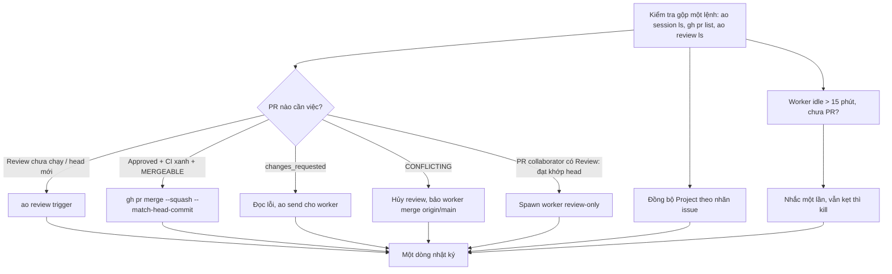

# 02. Orchestrator trên AO

AO (Agent Orchestrator) là công cụ chạy nhiều phiên agent song song, mỗi phiên một worktree git riêng. Orchestrator là một phiên đặc biệt (`--kind orchestrator`) chạy liên tục; nó điều phối các worker qua CLI `ao`.

## Áp dụng chung

### 1. Lệnh `ao` hay dùng

Hướng dẫn đầy đủ của CLI: `ao <lệnh> --help`, hoặc skill `using-ao` đi kèm AO.

| Việc | Lệnh |
|---|---|
| Liệt kê worker đang chạy | `ao session ls --project <id>` (thêm `--json`, `--include-terminated`) |
| Xem một phiên (nhánh, trạng thái) | `ao session get <id>` |
| Giao việc mới | `ao spawn --project <id> --name "<tên ngắn>" --prompt "<nội dung>"` (hoặc `--prompt` từ file) |
| Tiếp quản PR dở | `ao spawn … --claim-pr <số>` (thêm `--no-takeover` nếu không muốn giành từ phiên đang chạy) |
| Worker tự nhận PR | `ao session claim-pr <pr>` (chỉ cho việc *tiếp tục implement*, không dùng cho review-only) |
| Gửi tin cho worker đang chạy | `ao send --session <id> --message "<nội dung>"` |
| Chạy review native cho PR của worker | `ao review trigger <worker-id> [--pr <url>] [--rerun]` |
| Xem kết quả review | `ao review ls <worker-id> [--json]` (đọc `latestRun.targetSha`, `verdict`) |
| Dừng review đang chạy | `ao review cancel <worker-id>` |
| Tắt phiên | `ao session kill <id>` |
| Dọn worktree phiên đã tắt | `ao session cleanup --dry-run` rồi `-y` |
| Worker báo tiến độ | `ao report --checkpoint\|--needs-input\|--stuck\|--done --note "…" [--pr-created <url>] [--artifact <ref>]` |

Quy ước:
- `ao spawn` chạy **một lần** rồi đọc kỹ output; lần lỗi vẫn có thể đã tạo phiên (xem [08-bai-hoc.md](08-bai-hoc.md): spawn trùng).
- Tên phiên (`--name`) chỉ để hiển thị; định danh là id phiên.
- Link tới phiên trong chat: `ao://sessions/<project-id>/<session-id>` (chỉ mở được trong app AO đang chạy).

### 2. Mẫu prompt spawn

Prompt tốt trả lời được 6 câu: *Việc gì (issue nào)? Đọc gì? Làm thế nào? Ranh giới? Kiểm thử gì trước khi Ready? Xong thì làm gì?* Khung:

```
Việc: issue #<N> "<tiêu đề>". Đọc issue, <tài liệu thiết kế>, skill <tên skill>.
<Bối cảnh đã có trên main / PR liên quan>.

Làm (nhánh MỚI từ origin/main, PR nháp ngay 'Closes #<N>', nhãn dang-lam / agent:<tên> đã gắn):
- <gạch đầu dòng hành vi cần có>
- ...

Phối hợp: <worker khác đang sửa file nào> → chỉ sửa phần của bạn, merge origin/main thường xuyên (không rebase).

Trước khi Ready: <lệnh kiểm tra>, ảnh trước/sau nếu đổi giao diện.
LUẬT MÁY: <cổng, dọn tiến trình, âm thanh, tài nguyên chung>.
Không force push, không push main. Xong: Ready + ao review trigger + báo orchestrator.
```

Các mẫu đầy đủ (code, ảnh, sửa bot, review-only, tiếp quản PR): [templates/prompt-mau.md](templates/prompt-mau.md).

### 3. Nhịp kiểm tra (heartbeat)

Orchestrator không "ngồi chờ": nó chạy theo **nhịp** (khoảng 20–30 phút một lần) bằng lịch cron. Hai quy tắc giữ ngữ cảnh gọn:
- **Hướng dẫn nhịp để ở một file** (`nhip-kiem-tra.md`), lịch cron chỉ **một dòng** trỏ tới file ("đọc và làm theo file X"). Đổi quy tắc thì sửa file, không sửa cron.
- **Nhịp yên lặng:** nếu không có gì mới thì chỉ ghi một dòng vào nhật ký và trả lời một câu. Không liệt kê lại, không nhắc báo cáo cũ đã xử lý, chỉ mở ảnh khi cần người dùng duyệt (còn lại đưa link).

Khung một nhịp (bản đầy đủ: [templates/nhip-kiem-tra.md](templates/nhip-kiem-tra.md)):



Điều kiện đáng nhớ:
- Worker xong việc (PR approved + merge) thì **tắt phiên** (trừ khi có việc tiếp theo cho nó).
- Mỗi lần merge xong: Project item của PR **và** issue → Status Xong, điền "Ngày xong" và "Bước lộ trình".
- PR mở thiếu nhãn `agent:<tác giả>` thì gắn bù (`gh pr edit <N> --add-label …`).

### 4. Merge nền: `cho-merge.sh`

Chờ review + CI rồi merge cần nhiều phút, không nên chặn nhịp. Script chạy nền (`run_in_background`): chờ AO review `approved` ở **đúng head hiện tại** → chờ CI → kiểm lại head chưa đổi và không check đỏ → `gh pr merge --squash --match-head-commit <sha>`. Head đổi hoặc review không đạt thì tự thoát (nhịp sau xử lý). Bản chép dùng ngay: [templates/cho-merge.sh](templates/cho-merge.sh).

```bash
bash cho-merge.sh <PR> <worker-session-id>      # chạy nền
```

### 5. Giới hạn tài nguyên

Máy dev thường là một máy cá nhân (còn dùng để chơi / làm việc), nên giới hạn bằng **luật**, không trông vào may mắn:
- **Số worker song song tối đa ~4** (tính cả review-only). Mức này đến sau sự cố tràn RAM khi chạy ~6 worker cùng lúc (xem [08-bai-hoc.md](08-bai-hoc.md)); người dùng có thể siết còn 2 khi cần máy cho việc khác.
- **Một cách chạy bot / server duy nhất** (công cụ dự án), tự chọn cổng trống, tối đa N lượt toàn máy; agent **không** tự bật server rời hay cơ sở dữ liệu riêng.
- **Cổng theo số phiên**: server `3000 + số phiên`, DB `5400 + số phiên` (ví dụ phiên 138 → 3138 / 5538). Script phải **kiểm cổng trước**; `EADDRINUSE` thì dừng, không nối vào server có sẵn.
- **Chỉ tắt tiến trình do mình bật** (theo PID con), không `taskkill` theo cổng hay theo tên.
- **Tài nguyên dùng chung ngoài máy** (máy sinh ảnh): tối đa 2 worker, mỗi worker 1 job một lần ([07-asset-pipeline.md](07-asset-pipeline.md)).
- **Chặn xung đột file**: không giao hai worker cùng sửa một file lớn mà không dặn "chỉ sửa phần của bạn, merge `origin/main` thường xuyên"; việc giao diện chung một file thì giới hạn 2 worker cùng lúc.

### 6. Xử lý sự cố điều phối

| Triệu chứng | Xử lý |
|---|---|
| Worker đã báo `[done]` nhưng `ao send` trả `SERVICE_UNAVAILABLE` / `INTERNAL_ERROR` | Thử tối đa 2 lần, rồi `ao session kill` và spawn worker mới; PR chưa đạt thì thêm `--claim-pr <N>` |
| Worker không nhận tin / kẹt, không có PR sau 15 phút | Nhắc một lần; vẫn kẹt thì kill + spawn lại |
| Hai worker cùng việc (spawn trùng) | Giữ bản có tiến độ hơn, kill bản còn lại, claim PR cho bản giữ; luôn kiểm `ao session ls` sau lỗi spawn |
| Lỗi `AGENT_SWITCH_IN_PROGRESS` khi gửi tin | Đang đổi harness giữa chừng; đừng chờ, spawn worker mới `--claim-pr` |
| PR `CONFLICTING` | `ao review cancel`, bảo worker `git merge origin/main` (không rebase), review lại |
| GitHub kẹt head cũ, CI không chạy trên main mới | Đóng rồi mở lại PR để kích CI ([05-testing.md](05-testing.md)) |
| Review treo quá lâu (~30 phút) | Chạy thêm reviewer song song: `ao review trigger <id> --rerun` |
| PR từng bị `request-changes`, tác giả đã sửa | Phải `gh pr review --approve` kèm ghi chú trước khi merge, nếu không ruleset chặn (BLOCKED) |
| Tràn RAM, nhiều phiên chết | Kill phiên lỗi, spawn lại từng cái, siết luật RAM |

### 7. Tài khoản, quota, model

- Mỗi phiên gắn **cố định** với tài khoản mặc định lúc spawn; AO **không tự đổi gói khi hết quota**, và CLI không có lệnh đổi tài khoản (đổi trong cài đặt app).
- Worker gặp rate limit / hết quota → `ao session kill` và spawn lại (kèm `--claim-pr` nếu PR dở) để chạy trên tài khoản mặc định mới. Không sửa tay cơ sở dữ liệu của AO.
- Cửa sổ ngữ cảnh worker mặc định đủ cho phần lớn việc; chỉ dùng model ngữ cảnh lớn (`--model`) cho việc đọc / sửa nhiều bản đồ hay refactor lớn, và kiểm tra build AO hiện tại có hỗ trợ (từng bị từ chối `UNSUPPORTED_MODEL`).
- Reviewer có thể chọn riêng: `ao review trigger --agent <harness> --model <id> --effort <mức>` cho một lượt.

### 8. File trạng thái, nhật ký và bộ nhớ (sống qua nén ngữ cảnh)

Orchestrator chạy hàng ngày nên ngữ cảnh bị nén liên tục. Mọi thứ cần nhớ phải nằm **trong file**, không trong hội thoại:

| Nơi | Chứa | Ai cập nhật |
|---|---|---|
| `nhip-kiem-tra.md` — mục *Quy tắc* | Các bước một nhịp | Khi đổi quy trình |
| `nhip-kiem-tra.md` — mục *Trạng thái* | Worker đang chạy, luật tạm (RAM, âm thanh, cổng), quyết định gần nhất, danh sách PR đã merge, hàng chờ | Khi đổi worker / hàng chờ; **ghi trước khi nén ngữ cảnh** |
| `nhat-ky.md` (nhật ký) | **Một dòng** mỗi việc: giờ, việc, kết quả | Mỗi nhịp có thay đổi |
| Bộ nhớ (memory) | Quy tắc người dùng chốt, bài học, quyết định, tham chiếu | Khi có quyết định mới hoặc bài học |
| Comment "Tiến độ" trong issue | Việc đã làm, bước tiếp theo, PR / nhánh | Worker / collaborator mỗi nhịp có thay đổi |

Bộ nhớ: mỗi mục là một file ngắn có frontmatter (`name`, `description`, `type`: *user / feedback / project / reference*), kèm **Why** (vì sao) và **How to apply** (khi nào áp dụng), và một chỉ mục `MEMORY.md` mỗi dòng một mục. Ví dụ loại nên lưu: luật người dùng đã chốt ("tối đa N worker"), cách làm đã được duyệt, cạm bẫy môi trường, quyết định loại một dịch vụ. Không lưu thứ có trong code / git.

## Ở Soul Land

### Lệnh thật
```bash
ao session ls --project soul_land_game
gh pr list --repo <OWNER>/<REPO> --state open --json number,headRefOid,mergeable
ao review ls soul_land_game-250 --json
ao review trigger soul_land_game-250 --pr https://github.com/<OWNER>/<REPO>/pull/<N>
gh pr merge <N> --squash --match-head-commit <sha-40-ký-tự>
ao spawn --project soul_land_game --name "ui-1-tui-do" --prompt "$(cat <ARTIFACTS>/p-351.txt)"
ao spawn --project soul_land_game --name "tiep-quan-367" --claim-pr 367 --prompt "$(cat <ARTIFACTS>/p-367.txt)"
```

### Nhịp và file trạng thái
- Lịch cron **một dòng** trỏ tới `<ARTIFACTS>/nhip-kiem-tra.md`; nhật ký một dòng mỗi việc ở `overnight-plan.md` (bản đầu tiên ghi cả chính sách merge của đêm đầu).
- Mục *Trạng thái* của `nhip-kiem-tra.md` ghi: luật RAM, luật âm thanh, danh sách worker và việc, quyết định người dùng theo ngày, collaborator và dải cổng, PR đã merge, hàng chờ. Được cập nhật trước mỗi lần nén ngữ cảnh.
- Điều kiện merge: AO review `approved` ở đúng head + CI `check-build` / `bot-ram` xanh (CI chỉ để tham khảo, không bắt buộc ở ruleset, nhưng đỏ thì tìm nguyên nhân trước) + `MERGEABLE`.

### Giới hạn thật
- Tối đa ~4 worker (người dùng bỏ giới hạn 2 vào 2026-10-23 nhưng giữ ~4 vì sự cố tràn RAM ngày 2026-10-22); giao diện chung `hud.ts` / `style.css` tối đa 2 worker; ảnh ComfyUI tối đa 2 worker dùng chung máy.
- Bot ở máy **chỉ** qua `npm run bot:local -- --only <nhóm> [--pg]` (tối đa 2 lượt toàn máy, PostgreSQL chung cổng 5433, tự dọn); bot đầy đủ để CI `bot-ram` chạy.
- Luật âm thanh: người dùng chơi game trên cùng máy nên **mọi Chrome (kể cả headless) phải có `--mute-audio`**; dòng này được chép vào mọi prompt worker có chạy Chrome / bot.
- Cổng Chrome CDP `9333` đã có người dùng: worker dùng cổng riêng (`--remote-debugging-port=0`).

### Tài khoản
Hai tài khoản Claude (đăng nhập máy và gói Team). Ngày 2026-10-23 mặc định đổi sang Team; worker cũ xong việc hoặc báo hết quota thì kill + spawn lại.
