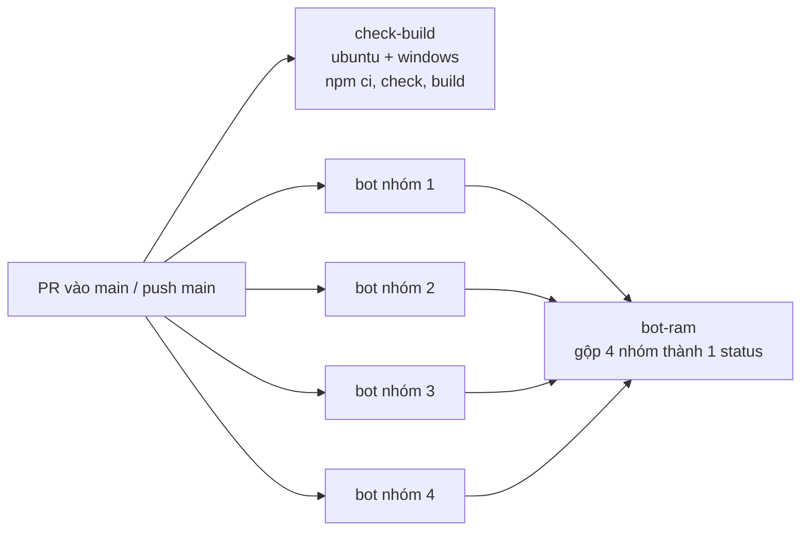

# 05. Kiểm thử

Ba tầng, nhanh tới chậm. Mỗi tầng chặn một loại lỗi và có chỗ chạy riêng.

| Tầng | Chặn gì | Chạy ở đâu | Thời gian |
|---|---|---|---|
| Lệnh `check` + hook | Lỗi kiểu / cấu hình / dữ liệu tĩnh | Máy dev (sau mỗi lần sửa) + pre-commit + CI | giây → phút |
| Bài kiểm thử hành vi (bot) | Luồng chơi hỏng, hồi quy | Máy dev (chọn nhóm) + CI | phút |
| Soát bằng người / agent (review) | Sai thiết kế, lỗ hổng, sai phạm vi | [04-review-code.md](04-review-code.md) | — |

## Áp dụng chung

### 1. Một lệnh `check` duy nhất + hook

- Dự án có **một lệnh** gom mọi kiểm tĩnh (typecheck, validate dữ liệu, kiểm file sinh tự động). Agent chạy lệnh đó **sau mỗi thay đổi**; CI chạy lại đúng lệnh đó, không lệnh riêng khác.
- **Git pre-commit hook** chỉ kiểm file đã stage (nhanh), bật một lần bằng một lệnh (`git config core.hooksPath .githooks`). Không bỏ qua bằng `--no-verify`.
- **Hook của agent** (Claude Code `PostToolUse` sau Edit / Write) chạy kiểm nhẹ sau mỗi lần agent sửa file để lỗi hiện ra ngay.
- **Bẫy:** worktree mới chưa có `node_modules` thì lệnh check in "bỏ qua, chưa cài thư viện" mà **vẫn thoát 0**. Cài thư viện trước rồi mới tin kết quả.

### 2. Bài kiểm thử hành vi (ở đây là bot) chạy một cách duy nhất

Nếu kiểm thử cần server / cơ sở dữ liệu / trình duyệt, **đóng gói thành một công cụ chạy cục bộ** và bắt mọi agent dùng nó (không ai tự bật server riêng). Công cụ tốt:
- tự chọn **cổng trống**, không nối vào server có sẵn;
- build một lần, cache theo hash nguồn; đặt trần bộ nhớ cho server và bot;
- **giới hạn toàn máy** (khóa theo file có PID + thời điểm, tự gỡ khóa của tiến trình đã chết; lượt thừa tự chờ);
- **chỉ tắt tiến trình con của chính nó** (kể cả khi Ctrl+C / lỗi) và in bộ nhớ đỉnh;
- một **cơ sở dữ liệu chung cho cả máy** (mỗi lượt một database riêng, xóa khi xong) thay vì mỗi agent một bản;
- chạy **một nhóm** bài (`--only <nhóm>`) để phản hồi nhanh; bài đầy đủ (rất lâu) để CI lo.

### 3. CI: hai job, cấu trúc nên chép



- **`check-build`**: cài đúng theo lockfile (`npm ci`), chạy lệnh check, build. Chạy trên cả hệ điều hành người dùng dùng.
- **`bot-ram`**: bài đầy đủ quá dài cho một job → **chia nhóm song song** (ma trận `BOT_PART`), mỗi nhóm một server mới; một job cuối gộp thành **một** status check để nhìn một chỗ. Mỗi bước bot có timeout riêng để treo thì vẫn còn log và artifact.
- **Đồng thời**: push mới lên cùng PR thì hủy lượt cũ (`concurrency … cancel-in-progress` chỉ cho PR; trên nhánh chính mỗi commit một nhóm riêng).
- Ghim action theo SHA đầy đủ (kèm chú thích phiên bản), `permissions: contents: read`, `persist-credentials: false`.
- Phần nào thuộc nhóm nào **khai báo ở một chỗ** trong file bot; bài mới thêm vào nhóm đang nhẹ nhất theo dòng thời gian từng phần mà mỗi nhóm in ra.
- Reviewer đọc CI thay vì chạy lại: `gh pr checks <N>`, `gh run view <run-id>` (số ✓ / ✗ / ⚠ từng nhóm), `gh run view <run-id> --log-failed`. Head chưa có lượt xong (đang chạy / bị hủy) thì **chờ lượt mới**.

### 4. Bài thử chập chờn

**Mặc định: ✗ trên nhánh chính mới nhất là lỗi thật.** Không "chạy lại cho qua", không nới lỏng bài (tăng ngưỡng, bỏ dòng, nuốt lỗi) chỉ để xanh. Quy trình (chi tiết thành skill `bot-flakiness`):

1. **Tái hiện tất định**: mỗi lượt một server mới (state sạch), chạy tuần tự; ít nhất 3 lượt mới gọi là chập chờn (1/2 chỉ là nghi ngờ). Thu hẹp: chạy riêng khối bị trượt; không có thì viết script chỉ lặp đúng thao tác trượt 20–40 lần. Ghi tỉ lệ trượt từng dòng.
2. **Đối chứng nhánh chính**: trượt cả trên `origin/main` thì không phải do nhánh đang làm → tạo issue riêng, không sửa lẫn vào PR. Chạy main cạnh nhánh bằng `git archive origin/main` ra thư mục tạm.
3. **Tìm gốc**: đọc **dòng ✗ đầu tiên** (một ✗ thường kéo hàng chục ✗ sau); thêm **chẩn đoán vào chính dòng ✗** (vị trí, sinh lực, log gần nhất) thay vì đoán.
4. **Sửa**: *chờ theo state, không `sleep` cố định* (`waitFor(() => điều_kiện)` có hạn chót); sửa ở bot nếu bot đo sai, ở server nếu lỗi thật.
5. **Chứng minh bằng số lần chạy**: script tái hiện 0 trượt / N lượt, rồi bài đầy đủ nhiều lần ở mọi chế độ (RAM và có DB). Ví dụ yêu cầu trong prompt: ≥ 5 lần nhóm liên quan + 2 lần mỗi `--part` tương ứng.
6. **Ghi vào issue** nhãn `bot-test`: commit, chế độ, số lượt, tỉ lệ từng dòng, dòng ✗ đầu tiên, nghi vấn. PR sửa có bảng lượt trước / sau và xác nhận không bài nào bị nới.

Nguồn chập chờn thường gặp:

| Nguồn | Dấu hiệu | Sửa |
|---|---|---|
| Tin tới trước bản vá trạng thái | log đúng nhưng đọc state ngay thì cũ | chờ state đổi sau tin |
| `sleep` cố định cho "hết sau T giây" | trượt khi máy tải | `waitFor` điều kiện |
| Cửa sổ vị trí hẹp hơn quãng đi mỗi nhịp | bước qua đích | gần đích đẩy nhẹ |
| Nhận đối tượng theo vị trí / "mới đầu tiên" | nhận nhầm | dùng id do hook trả |
| Thực thể hoang can thiệp | nửa máu, đổi bất ngờ | dọn quanh chỗ đứng |
| Bài trước để lại trạng thái | bài sau trượt, chạy riêng thì qua | trả trạng thái cuối bài, khẳng định trạng thái đầu bài sau |
| Giờ thật (boss, lịch) | chỉ trượt vào khung giờ | đồng hồ test đứng yên, đặt được |
| Máy tải cao | trượt lẻ | chạy tuần tự lấy kết quả sạch, vẫn sửa bằng chờ theo state |

### 5. Kích CI lại, đóng / mở PR

- Push mới tự chạy CI. Cần **chạy CI trên `main` mới** mà không có commit mới (hoặc GitHub kẹt head cũ): **đóng rồi mở lại PR**; đừng push commit rác (và đừng push khi PR đang đóng băng review).
- CI hủy / hết giờ do runner chậm chưa chắc là lỗi bot: phân biệt "có nhóm trượt" với "bị hủy / hết giờ".
- Bot lỗi thì log đầy đủ ở artifact của lượt chạy.

### 6. Chụp ảnh giao diện bằng Chrome headless

PR đổi giao diện / sprite **bắt buộc có ảnh trước / sau**. Công thức:
- **Luôn `--mute-audio`** (người dùng có thể đang dùng máy). Mở trình duyệt khác thì đặt cài đặt âm thanh tắt trong localStorage trước.
- **Không dùng cổng CDP mặc định đã có người dùng** (9222 / 9333): dùng `--remote-debugging-port=0` rồi đọc `DevToolsActivePort` trong thư mục `--user-data-dir` tạm.
- Nối WebSocket bằng `127.0.0.1` (không `localhost`), nếu không dễ điều khiển nhầm trình duyệt khác.
- Server của lần chụp ở cổng theo số phiên, **kiểm cổng**, tắt đúng PID mình bật (lấy `winpid` từ `/proc/$!` khi `exec node`).
- Build client **trước** khi bật server (server chỉ phục vụ thư mục build nếu đã có lúc khởi động).
- GPU thật nhanh hơn nhiều so với SwiftShader (`--use-angle=d3d11 --enable-gpu --ignore-gpu-blocklist` trên Windows); đo bố cục bằng `getBoundingClientRect` trước khi tin ảnh; giả lập điện thoại bằng `Emulation.setDeviceMetricsOverride` + chạm bằng `Input.synthesizeTapGesture`.
- Lượt "trước" lấy file từ `origin/main` bằng `git restore --source=origin/main --worktree -- <file>`; **commit trước** (restore về HEAD xóa thay đổi chưa commit).
- Ảnh đặt trong thư mục artifact (ngoài repo) hoặc đính vào PR; trang so cặp HTML gọn cho người duyệt.

## Ở Soul Land

### Lệnh
```bash
npm run install:all     # cài thư viện server + client (clone mới / worktree mới)
npm run hooks           # bật pre-commit (.githooks/pre-commit → node tools/check.mjs --staged), một lần
npm run check           # typecheck server + client, validate sprite, kiểm tiles.json, kiểm audio, kiểm bản đồ
npm run build           # build client (tsc + vite)

npm run bot:local -- --only <nhóm>            # một nhóm, RAM, cổng trống, tự dọn
npm run bot:local -- --only <nhóm> --pg       # thêm PostgreSQL chung (bắt buộc khi đổi SQL / db.ts)
npm run bot:local -- --part 1                 # một trong 4 nhóm CI (--part 1..4)
npm run bot:local -- --channels               # lượt nhiều kênh (CHANNEL_MAX=2)
npm run bot:local -- --help                   # liệt kê nhóm
npm run bot:local -- --pg-status              # xem / --pg-stop tắt PostgreSQL chung

npm run test:predict --prefix client          # dự đoán chuyển động
npm run test:audio --prefix client            # SFX, nhạc nền
npm run test:ratelimit --prefix server
npm run test:accounts --prefix server
```

- `bot:local` build server một lần (esbuild, cache theo hash nguồn), chạy `node` với trần heap 768 MB, `GAME_TEST=1`, cổng trống, state sạch; tối đa **2 lượt cùng lúc trên cả máy** (khóa ở thư mục tạm); PostgreSQL chung cổng 5433, mỗi lượt một database riêng (`soulbot_<phiên>_<pid>`, có dấu `COMMENT ON DATABASE` để công cụ chỉ dọn đúng thứ của nó), **bật server hai lần liên tiếp** (migration phải chạy lại an toàn).
- `GAME_TEST=1` bật hook `test` cho bot; lịch boss đứng yên ở 12:00 giờ Việt Nam trừ khi `--env BOSS_CLOCK=HH:MM` (hoặc `real`).
- **Không** dùng `npm run dev:server` để chạy bot (`tsx watch` sinh tiến trình cha tự bật lại server); không tự bật embedded-postgres riêng.
- CI `.github/workflows/check.yml`: `check-build` (ubuntu + Windows) và `bot-ram` (4 nhóm `bot-ram (nhóm 1..4)` + job gộp `bot-ram`; nhóm 1 chạy thêm `test:predict`, `test:ratelimit`, `test:accounts` và lượt nhiều kênh). Bot đầy đủ ~25 phút → mỗi nhóm ~7 phút; bước bot quá 12 phút coi là treo. Chạy lại một nhóm ở Linux / macOS: `BOT_PART=2 bash tools/ci/bot-run.sh nhom-2`.
- CI **không bắt buộc** trong ruleset (chủ repo chốt) nhưng reviewer luôn đọc.
- Bot không assert mọi thứ: đọc output (dòng ✗ là lỗi, ⚠ là bị bỏ qua) và log server. Luồng mới thì thêm vào `client/scripts/bot-test.mjs`, gắn đúng một nhóm trong `INLINE` / `STANDALONE`.
- **Ví dụ sửa chập chờn thật:** bài `tideTest` chờ "hết gầm" bằng sleep cố định → thay bằng chờ điều kiện có hạn chót + chẩn đoán trong dòng ✗ (#364); phần đầu chung `ra khỏi làng để thử tiên cơ` trượt chập chờn → đọc chẩn đoán, tìm chỗ chờ theo giờ (#368). Chi tiết ca cũ nằm trong skill `bot-flakiness` (PR #28, #36, #71, #140).
- **Ảnh trước / sau:** script mẫu `run<N>.sh` + `shot<N>.mjs` trong thư mục artifact của từng phiên; Chrome luôn `--mute-audio`, cổng CDP riêng, không dùng `9333`.
- **Đo hiệu năng dài:** skill `soak-perf` (nhiều bot trên bản đồ ×8, đo tick / bản vá / băng thông / bộ nhớ); tài liệu số đo ở `docs/tech/hieu-nang-soak.md`.
