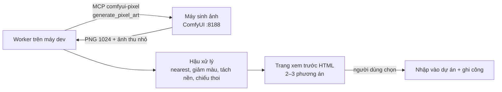

# 07. Dây chuyền ảnh (ComfyUI tự host)

Quy trình làm ảnh bằng mô hình sinh ảnh chạy trên **máy của chính bạn** (không tốn lượt, không phụ thuộc dịch vụ có thể bị tắt), với người dùng duyệt trước khi ảnh vào sản phẩm.

## Áp dụng chung

### 1. Kiến trúc



- Máy sinh ảnh (GPU / Apple Silicon) chạy ComfyUI với `--listen` để máy dev trong LAN gọi được. **IP LAN có thể đổi** khi mạng cấp lại: đọc từ hằng đầu `server.py`, **không ghi IP vào tài liệu / prompt** (dùng `<MAC_IP>`).
- Máy dev gọi qua một **MCP server** nhỏ (Python) đóng gói workflow ComfyUI thành tool `generate_pixel_art(...)`. Mã MCP và workflow JSON nằm **ngoài repo**.
- Model cần tải một lần (kiểm giấy phép từng thứ và ghi vào file ghi công):

| Model | Thư mục ComfyUI | Giấy phép |
|---|---|---|
| SDXL base 1.0 | `models/checkpoints/` | CreativeML Open RAIL++-M |
| LoRA `pixel-art-xl` | `models/loras/` | CreativeML Open RAIL++-M |
| VAE `sdxl-vae-fp16-fix` | `models/vae/` | MIT |
| (tùy chọn) LoRA `lcm-lora-sdxl` — chế độ nhanh 8 bước | `models/loras/` | theo trang model |

  Tải bằng `curl -L --fail -C -` (tải tiếp được khi đứt) từ trang model; nếu dùng host cần đăng nhập thì dùng `<HF_TOKEN>` **chỉ trên máy sinh ảnh**, không đưa vào repo. VAE fp16-fix tránh ảnh đen / nhiễu của SDXL fp16 trên Apple Silicon. Cần ≥ 8 GB trống.

### 2. Workflow (SDXL + LoRA + LCM)

Chuỗi node: Checkpoint (SDXL) → LoRA pixel-art (1,1; trong chế độ LCM là 1,0) → [LoRA LCM] → CLIP prompt dương / âm → KSampler → VAE decode (fp16-fix) → lưu ảnh gốc 1024 → **ImageScale `nearest-exact` về 1/8 (128 px)** → **ImageQuantize ~24 màu, không dither** → lưu ảnh kết quả.
- `mode="full"`: 28 bước, `dpmpp_2m` / `karras`, cfg 6,5.
- `mode="lcm"` (mặc định): 8 bước, sampler `lcm` / `sgm_uniform`, cfg 1,5; chất lượng gần ngang, **~85 giây thay vì ~180 giây** mỗi ảnh trên M4 Pro 16 GB.
- **img2img**: `init_image` (ảnh dẫn) + `denoise` (0,05–1, mặc định 0,75; thấp = sát ảnh dẫn, cao = sáng tạo nhưng dễ lệch góc).

### 3. Quy trình một đợt ảnh

1. **Chuẩn bị yêu cầu** (issue): bảng ảnh cần, cỡ, vị trí dùng, tiêu chí xong.
2. **Sinh 2–4 seed mỗi vật** (giữ ảnh gốc 1024 để so). Prompt: `[chủ thể tả hình bằng tiếng Anh] + [góc nhìn] + [màu theo vùng] + [nét] + [nền]`. Tên riêng trong tác phẩm không có nghĩa với model → **tả hình thay vì gọi tên**.
3. **Góc nhìn khó bằng chữ:** model vẽ công trình nhìn thẳng dù có chữ "isometric". Giải pháp: **ảnh dẫn** do công cụ trong repo dựng (khối thô đúng phép chiếu: tường sáng / tối, mái, cửa) + img2img `denoise ~0,75`. Ô nền (texture phủ kín) thì xin texture vuông nhìn thẳng từ trên, liền mép rồi **chiếu thành thoi** bằng công cụ.
4. **Hậu xử lý**: tách nền (loang từ mép qua nền trắng / xám + bóng; viền tối của vật chặn đường loang; xóa khe nền kín giữa cột / chân thú), chiếu thoi cho ô nền, đưa về bảng màu của dự án, viền chuẩn.
5. **Trang xem trước HTML** (ảnh gốc 1024 / sau xử lý / **so cùng tỉ lệ với đồ đã có trong game**) ở thư mục artifact; **báo orchestrator đường dẫn** để người dùng xem.
6. **Người dùng duyệt** (chọn 1 trong 2–3 phương án; có thể yêu cầu làm lại). **Chưa duyệt thì không đưa vào sản phẩm.** Mẫu đã duyệt trở thành chuẩn phong cách cho các lô sau.
7. **Nhập vào dự án** bằng dây chuyền công cụ, chụp ảnh trong game (ngày + đêm, các mức phóng), chạy `check` và bài thử liên quan.
8. **Ghi công** (CREDITS): mỗi ảnh một dòng với công cụ, **prompt, negative, seed, ảnh dẫn**, lệnh nhập — để vẽ lại đúng ảnh được. Asset ngoài (LPC, v.v.): tác giả, URL, giấy phép, có sửa gì; giấy phép SA / GPL / NC ghi cờ.

### 4. Dùng chung máy sinh ảnh

- Máy sinh ảnh là **tài nguyên đơn**: mỗi lần **một job**. Trước khi gửi kiểm hàng đợi trống: `curl -s http://<MAC_IP>:8188/queue` (`queue_running` và `queue_pending` rỗng; có thể phiên khác đang dùng).
- Không hủy job của người khác, không đổi cấu hình / model trên máy sinh ảnh. Máy tắt hoặc ComfyUI lỗi thì **báo orchestrator**, không tự chuyển sang dịch vụ khác.
- Số worker dùng chung: **tối đa 2** (khi một worker đang hậu xử lý thì máy rảnh); hàng đợi của ComfyUI tự xếp lượt. Giao issue ảnh lần lượt.
- Ước lượng: lô 4 vật × 3 seed ≈ 1 giờ ở chế độ LCM.
- Xem tiến độ: websocket `ws://<MAC_IP>:8188/ws?clientId=<tên>` (tin `progress`).

### 5. Phạm vi hợp / chưa hợp

| Hợp | Chưa hợp |
|---|---|
| Vật đứng, công trình (có ảnh dẫn), biểu tượng vật phẩm, ô nền, chân dung bán thân, ảnh tĩnh sinh vật | Nhân vật / sinh vật **nhiều hướng có hoạt ảnh** (không giữ cùng một vật giữa các hướng / khung); thử riêng, tách issue |

## Ở Soul Land

- **Mục tiêu hình:** isometric kiểu thế giới cổ điển, ô logic là thoi **32×16** (ô lớn 64×32 phủ 2×2), pixel art nét hơn 48×48, ánh sáng / chiều sâu. Quy tắc ở `GAME_DESIGN.md` mục 5.11; quy cách chi tiết (sheet, key, thư mục) ở `tools/assets/README.md`; thao tác ở skill `asset-gen` (mục 10 là ComfyUI).
- **Công cụ trong repo (`tools/assets/`):** `comfy-guide.mjs` (ảnh dẫn khối isometric đúng phép chiếu), `comfy-key.mjs` (tách nền, `--shadow`, `--holes`, `--diamond 128` chiếu thoi), `gemini-import.mjs` (nhập về khung / bảng màu), `iso-build.mjs ground|prop` (đưa vào game), `validate.mjs --register` (ghi `art/CREDITS.md`), `preview.mjs` / `iso-preview.mjs` (soát cạnh asset cùng vùng).
- **Lệnh mẫu** (thay `<art>`, `<tmp>` bằng thư mục artifact / tạm của phiên):

```bash
node tools/assets/comfy-guide.mjs <art>/dan_nha.png --w 3 --d 2.2 --h 1.25 --roof 1.6
# rồi: generate_pixel_art(prompt, output_path, init_image="<art>/dan_nha.png", denoise=0.75, mode="lcm", raw_path=…)
node tools/assets/comfy-key.mjs <art>/den_long_101.png <tmp>/den_long.png --shadow --holes 20
node tools/assets/comfy-key.mjs <art>/o_co_101.png <tmp>/o_co.png --diamond 128
node tools/assets/gemini-import.mjs --kind tile   --cell 1 --logo off --grid 1x1 --names co_rung_moi --out <tmp>/tile <tmp>/o_co.png
node tools/assets/gemini-import.mjs --kind object --size 48x96 --cell 1 --logo off --grid 1x1 --names den_long_da --out <tmp>/obj <tmp>/den_long.png
node tools/assets/gemini-import.mjs --kind item   --cell 1 --logo off --grid 1x1 --names hoi_thanh_phu --out <tmp>/item <tmp>/phu.png
```

- **Prompt tả hình thay vì gọi tên:** "Hồi Thành Phù" → `one vertical strip of yellow paper with red ink rune symbols and a red seal stamp`; "Phong Lang" → `grey wind wolf, slate grey fur with pale blue-white wind-swept tufts`; kiến trúc → `ancient chinese village house, curved grey clay tile roof with upturned eave corners`.
- **Màu:** `muted desaturated earthy colors` + màu chủ đạo vùng, `soft sunlight from top left`; thủy mặc chỉ cho mảnh giao diện, không cho vật trong thế giới. Nét: `crisp pixel clusters, dark outline`. Nền: `no ground, no base, isolated on plain white background`. Không vẽ mắt phát sáng, hào quang, vòng hồn hoàn, bóng (client vẽ). Không tên họa sĩ, tên game thương mại.
- **Chân dung hồn thú (đã duyệt):** `close-up bust portrait, head and front shoulders only, head turned three-quarters to the right, the head fills most of the frame`; model hay quay trái → lật ngang.
- **Luật một bản đồ một nguồn ô nền:** không trộn ô ComfyUI với ô Gemini / ô cũ trên cùng bản đồ.
- **Phân nguồn hiện hành:** ComfyUI cho vật đứng, công trình, ô nền, chân dung hồn thú, ảnh tĩnh; Gemini / LPC giữ cho biểu tượng vật phẩm, NPC phụ, giao diện đã có; hoạt ảnh 8 hướng bằng ComfyUI đã dừng (#335 / #387 đóng): hồn sư LPC, phụ thể ảnh tĩnh + chuyển động code, hồn thú kiểu lai; họ asset giao diện C1–C16 do Codex (tthoadev); PixelLab chỉ cho hoạt ảnh kỹ năng / pháp tướng / xoay hướng.
- **Luật vận hành:** tối đa 2 worker dùng chung máy sinh ảnh, 1 job / lần; mọi ảnh vào game **do chủ repo duyệt từ trang xem trước**; ảnh gốc và thư mục làm việc để **ngoài repo**; Chrome khi chụp luôn `--mute-audio`; ảnh vào game kèm dòng CREDITS (prompt, negative, seed, ảnh dẫn).
