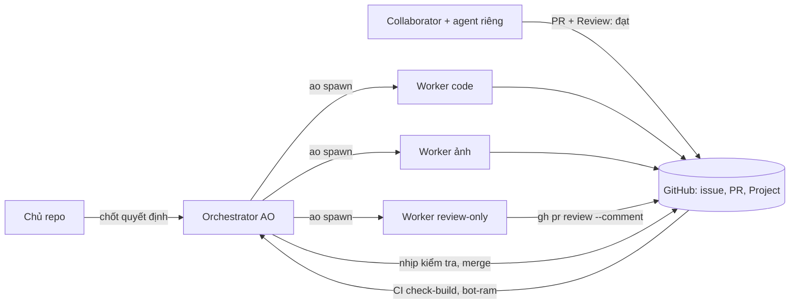

# Quy trình làm việc (workflows)

Thư mục này ghi lại **cách dự án làm việc với nhiều agent AI cùng lúc**: một orchestrator điều phối, nhiều worker làm song song, collaborator bên ngoài tự có agent riêng, mọi việc đi qua issue / PR GitHub và được review, kiểm thử trước khi merge. Mục đích: **người dùng mang cả bộ quy trình này sang dự án khác**.

Mỗi file có hai phần:
- **Áp dụng chung**: quy trình, lý do, lệnh mẫu; không phụ thuộc Soul Land.
- **Ở Soul Land**: ví dụ thật của repo này (nhãn, lệnh, số liệu) để bạn thấy quy trình chạy ra sao.

> Chỗ giữ trong tài liệu: `<OWNER>/<REPO>` (repo GitHub), `<MAC_IP>` (máy sinh ảnh), `<HF_TOKEN>` (token dịch vụ ngoài), `<tên>` (tên người / agent), `<N>` (số issue / PR), `<ARTIFACTS>` (thư mục artifact AO của phiên orchestrator). **Không bao giờ ghi key, token, email, IP thật vào repo, log, PR.**

## Mục lục

| File | Nội dung |
|---|---|
| [01-tong-quan.md](01-tong-quan.md) | Vai trò (chủ repo, orchestrator, worker, review-only, collaborator) và vòng đời issue → PR nháp → review → CI → merge → Project "Xong" |
| [02-orchestrator-ao.md](02-orchestrator-ao.md) | Cách chạy orchestrator trên AO: lệnh `ao`, mẫu prompt spawn, nhịp kiểm tra, `cho-merge.sh`, giới hạn worker, xử lý sự cố, tài khoản / quota, file trạng thái + bộ nhớ |
| [03-collaborator.md](03-collaborator.md) | Phối hợp nhiều người: nhãn, bảng Project, nhận việc, PR nháp, "Review: đạt" + SHA, luật merge, ruleset |
| [04-review-code.md](04-review-code.md) | AO review, review-only cho PR người khác, AO approval ≠ GitHub approval, đóng băng PR, chuyển lỗi review |
| [05-testing.md](05-testing.md) | `npm run check` + hook, bot, CI, bot chập chờn, kích CI lại, chụp ảnh headless |
| [06-skills-mcp.md](06-skills-mcp.md) | 11 skill của dự án, cách viết skill mới, MCP / plugin, dịch vụ đã đánh giá và loại |
| [07-asset-pipeline.md](07-asset-pipeline.md) | Dây chuyền ảnh ComfyUI tự host: sinh, hậu xử lý, duyệt, ghi công, dùng chung máy sinh ảnh |
| [08-bai-hoc.md](08-bai-hoc.md) | Bài học thực tế (sự cố, nguyên nhân, cách phòng) |
| [templates/](templates/) | Mẫu dùng ngay: prompt (code, ảnh, sửa bot, review-only, tiếp quản PR), `nhip-kiem-tra.md`, `cho-merge.sh`, `SKILL.md`, checklist `CLAUDE.md` / `CONTRIBUTING.md` |

Thứ tự đọc gợi ý: 01 → 03 → 02 → 04 → 05, rồi 06–08 khi cần.

## Sơ đồ tổng

## Checklist một trang: áp dụng cho dự án mới

Làm lần lượt; mỗi bước có chi tiết ở file ghi bên phải.

1. **Luật cho agent trong repo** (`CLAUDE.md`, `AGENTS.md`, `CONTRIBUTING.md`): quy tắc code, lệnh kiểm thử, quy trình nhận việc → [templates/checklist-repo-moi.md](templates/checklist-repo-moi.md), [01](01-tong-quan.md).
2. **Nhãn GitHub + Project**: `san-sang`, `dang-lam`, `cho-review`, `chan`, `agent:<tên>`, loại việc; Project có Status (Chờ / Sẵn sàng / Đang làm / Đang review / Xong) và Chủ → [03](03-collaborator.md).
3. **Mẫu issue + mẫu PR + CODEOWNERS** trong `.github/` → [03](03-collaborator.md).
4. **Một lệnh kiểm tra duy nhất** (`npm run check` hoặc tương đương) + git hook typecheck + CI chạy lại đúng lệnh đó → [05](05-testing.md).
5. **Bảo vệ nhánh chính (ruleset)**: chỉ vào qua PR, squash, cấm force push → [03](03-collaborator.md).
6. **Cài AO, đăng ký project**, chọn agent / model cho worker và reviewer → [02](02-orchestrator-ao.md).
7. **Viết file quy tắc nhịp** (`nhip-kiem-tra.md`), đặt lịch cron một dòng trỏ tới file đó → [02](02-orchestrator-ao.md), [templates/nhip-kiem-tra.md](templates/nhip-kiem-tra.md).
8. **Chép `cho-merge.sh`**, sửa đường dẫn worktree → [templates/cho-merge.sh](templates/cho-merge.sh).
9. **Đặt giới hạn tài nguyên**: số worker tối đa, một lệnh chạy bot duy nhất, cổng riêng theo số phiên, luật dọn tiến trình → [02](02-orchestrator-ao.md), [05](05-testing.md).
10. **Skill dự án**: bắt đầu bằng 3–4 skill cho việc lặp lại nhiều nhất → [06](06-skills-mcp.md), [templates/SKILL.md](templates/SKILL.md).
11. **Bộ nhớ orchestrator**: file ghi quyết định / luật / bài học để sống qua lần nén ngữ cảnh → [02](02-orchestrator-ao.md).
12. **Thử một vòng nhỏ**: một issue nhỏ → worker → PR nháp → AO review → CI → merge, rồi mới tăng số worker.

## Phần dùng chung và phần riêng Soul Land

| Phần | Dùng chung (mang đi nguyên) | Riêng Soul Land (thay bằng của dự án bạn) |
|---|---|---|
| Vai trò, vòng đời issue → merge | Toàn bộ | Tên nhãn tiếng Việt, tên giai đoạn (`giai-doan-10`, `giai-doan-11`) |
| Lệnh `ao`, nhịp kiểm tra, `cho-merge.sh` | Toàn bộ | Tên project / đường dẫn worktree trong script |
| Nhãn, Project, "Review: đạt" + SHA | Cơ chế | Trường Project `Giai đoạn`, `Bước lộ trình`, `Chủ` |
| Review AO / review-only | Toàn bộ | Danh mục soát (server-authoritative, `shared/data.ts`) |
| `check` / hook / CI | Cấu trúc 2 job (kiểm tĩnh + kiểm hành vi) | `bot:local`, `bot-ram` 6 nhóm, PostgreSQL chung |
| Bot chập chờn | Quy trình tái hiện / đối chứng / chờ theo state | Bảng nguyên nhân cụ thể của `bot-test.mjs` |
| Skill | Khung `SKILL.md`, cách viết | 11 skill game (balance, anti-cheat, asset…) |
| Ảnh | Quy trình duyệt 2–3 phương án, hàng đợi 1 job / lần | ComfyUI + LoRA pixel-art-xl, isometric 32×16 |
| Bài học | Mọi bài học về điều phối | Bài học về phòng game, boss, Colyseus |
